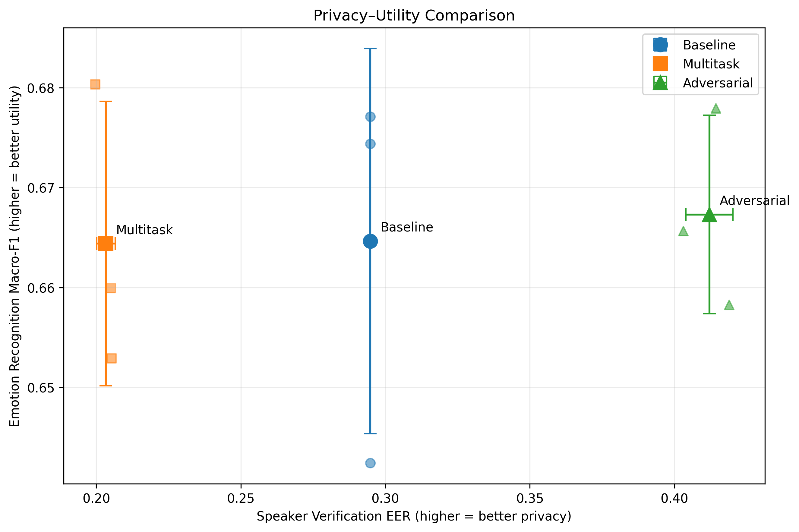

# Speaker Disentanglement via Adversarial Representation Learning

Reducing speaker-identity recoverability in WavLM speech representations
while preserving emotion-recognition utility, using a Gradient Reversal Layer.

## Results

Mean ± std over three representation-training seeds (7, 21, 100), evaluated
on 14 held-out CREMA-D speakers with an independent speaker-verification
attacker.

| Model | Emotion Macro-F1 ↑ | Emotion Accuracy ↑ | Speaker AUC ↓ | Speaker EER ↑ |
|---|---|---|---|---|
| Baseline (frozen WavLM) | 0.6646 ± 0.0193 | 0.6617 ± 0.0180 | 0.7802 ± 0.0000 | 0.2948 ± 0.0000 |
| Multitask (no GRL)      | 0.6644 ± 0.0142 | 0.6620 ± 0.0133 | 0.8778 ± 0.0010 | 0.2034 ± 0.0032 |
| **Adversarial (GRL)**   | **0.6673 ± 0.0099** | **0.6623 ± 0.0107** | **0.6229 ± 0.0084** | **0.4121 ± 0.0082** |



*Speaker-verification EER vs. emotion Macro-F1. Individual seed points are
small markers; large markers with error bars are means ± std. Higher EER and
higher Macro-F1 are both better.*

**Key finding.** Multitask learning alone *increases* speaker recoverability
relative to the baseline. The Gradient Reversal objective is what reduces it,
at no measured cost to emotion accuracy.

**Note on the baseline std.** The baseline attacker AUC/EER have zero
standard deviation across seeds because the baseline operates on frozen
WavLM embeddings — they are identical for every representation-training
seed, and the attacker initialization is fixed at seed 42. This is expected,
not a bug.

## Method

Frozen `microsoft/wavlm-base-plus` → mean-pooled 768-d utterance embeddings.

- **Baseline:** emotion head (768 → 128 → 6) trained on frozen embeddings.
- **Multitask:** shared projection (768 → 512 → 256); emotion head
  (256 → 128 → 6) and speaker head (256 → 128 → 64) trained jointly.
- **Adversarial:** same as multitask, with a Gradient Reversal Layer (λ = 1.0)
  between the shared representation and the speaker head.

Privacy is evaluated with an **independent** MLP attacker on matched pairs
`(|z_i − z_j|)`, trained on 64 training speakers, validated on 13, and tested
on 14 unseen speakers. Pairs are matched on emotion and on the same sentence
IDs across positive and negative groups.

## Repository layout

```
├── configs/default.yaml          # experiment config
├── data/                         # (gitignored) raw + processed
├── notebooks/
│   ├── 01_extract_wavlm_embeddings.ipynb
│   └── 02_train_and_evaluate.ipynb
├── src/
│   ├── data/                     # prepare, split, extract, dataset
│   ├── models/                   # grl, projection, classifiers, model
│   ├── training/                 # training loop
│   └── evaluation/               # pairs, attack, metrics
└── results/
    ├── metrics/                  # final_results_by_seed.csv, *_summary.csv
    └── figures/
```

## Setup

```bash
git clone https://github.com/SepidehNorouziMotlagh/speaker-disentanglement-grl.git
cd speaker-disentanglement-grl
python -m venv .venv && source .venv/bin/activate
pip install -r requirements.txt
```

## Data

Download CREMA-D (AudioWAV only) from
<https://github.com/CheyneyComputerScience/CREMA-D> and place under
`data/raw/AudioWAV/`. Then:

```bash
python -m src.data.prepare_dataset --audio-dir data/raw/AudioWAV
python -m src.data.split_dataset
```

This produces `data/processed/cremad_metadata.csv` and
`data/processed/cremad_splits.csv`.

WavLM embeddings are not distributed — regenerate them with
`notebooks/01_extract_wavlm_embeddings.ipynb` (Colab T4 recommended,
~45 min for all three splits).

## Reproduction

Run `notebooks/02_train_and_evaluate.ipynb` end-to-end. It:
1. Trains the three conditions on seed 42 and evaluates them.
2. Runs the main verification attack and attacker-init robustness.
3. Retrains all three conditions on seeds 7, 21, 100, extracts
   representations, and re-runs the verification attacker (fixed seed 42).
4. Merges results, writes `results/metrics/*.csv` and
   `results/metrics/experiment_manifest.json`, and saves
   `results/figures/privacy_utility_comparison.png`.

## Design notes

- **Speaker-disjoint split.** Partitions are by speaker, not recording, so
  a model cannot memorize speaker characteristics from training that would
  inflate test performance.
- **Matched verification pairs.** Positive and negative pairs share emotion
  and the same pair of sentence IDs. This prevents the attacker from solving
  the task via sentence or emotion content rather than speaker identity.
  Intensity is **not** matched — a known limitation.
- **Shuffle-free extraction.** Training loaders shuffle for optimization;
  representations for the attacker are extracted with `shuffle=False` so
  rows align with metadata. Without this, the pair generator silently
  produces garbage.
- **Scaler fit on train only.** `StandardScaler` in the attacker is fit on
  training pairs and reused for validation and test.
- **Fixed attacker seed for the sweep.** When sweeping representation seeds,
  the attacker init is pinned at seed 42 so variation is attributed to the
  representations, not the attacker.

## Limitations

- Adversarial AUC remains above chance (0.6229 > 0.5) — residual speaker
  information is still detectable. We report reduced recoverability, not
  anonymization.
- Three training seeds; this is a robustness check, not a significance claim.
- One dataset (CREMA-D), one language (English), one attacker architecture.
- Intensity is not matched in the verification-pair protocol.
- This is a study of representation-level privacy, not a voice-anonymization
  system.